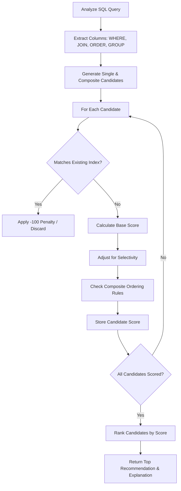

# Recommendation Algorithm Design

## 1. Candidate Generation
Candidates are generated by extracting specific column references from the SQL parse tree:
- **WHERE Clause:** Exact matches (`=`), ranges (`>`, `<`, `BETWEEN`), and `IN`.
- **JOIN Clause:** Columns used in `ON` conditions.
- **ORDER BY Clause:** Columns used for sorting.
- **GROUP BY Clause:** Columns used for grouping.

## 2. Candidate Evaluation & Scoring
This system uses a transparent application-level heuristic. **This score is NOT the MySQL optimizer's cost value.** It is an educational tool to rank indexes.

### Initial Scoring Framework
**Base Points (based on clause usage):**
- `WHERE` exact match: **+30**
- `JOIN` condition: **+25**
- `WHERE` range match: **+20**
- `ORDER BY` usage: **+20**
- `GROUP BY` usage: **+15**
- High Selectivity (>80% unique): **+10**
- Query Frequency multiplier: (Base * Frequency weight)

**Penalties:**
- Existing exact index: **-100** (Discard)
- Redundancy (prefix of existing composite): **-30**
- Low selectivity (e.g., boolean, <5% unique): **-20**
- High maintenance cost (very wide string columns): **-10**

## 3. Composite Indexes
When multiple columns are identified (e.g., WHERE user_id = X ORDER BY date DESC), the system evaluates a composite index.

**Column Order Rules (The "Rules of Thumb"):**
1. **Equality First:** Columns with exact match conditions (`=`, `IN`) go first.
2. **Sorting/Grouping Second:** Columns used in `ORDER BY` or `GROUP BY` go next.
3. **Ranges Last:** Columns with range conditions (`>`, `<`) go last, as the B-tree cannot efficiently traverse subsequent columns after a range scan.

*When NOT to recommend:* If adding columns to a composite index makes it overly wide and the trailing columns have low selectivity, it is penalized.

## 4. Limitations
The recommendation engine may be uncertain in the following cases:
- Queries using `LIKE '%text'` (B-tree cannot index leading wildcards).
- Complex OR conditions spanning multiple tables.
- Function-wrapped columns (e.g., `WHERE YEAR(date) = 2023`).
In these cases, the system will explicitly state the limitation in the explanation output.

## 5. Recommendation Algorithm Flowchart

