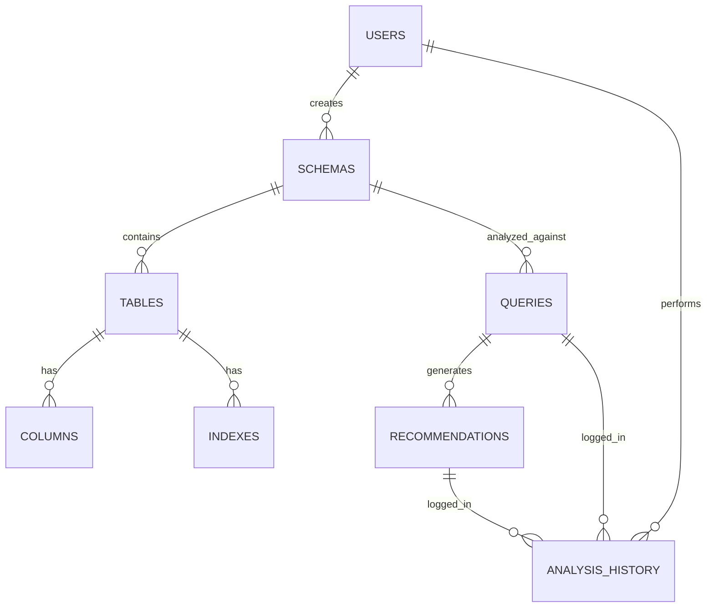

# Database Design

## 1. Entities and Tables

### `users`
- **Purpose:** Store user accounts (if authentication is implemented).
- `id` (INT, PK): Unique user identifier.
- `username` (VARCHAR): Login name.
- `created_at` (TIMESTAMP): Account creation date.

### `schemas`
- **Purpose:** Store logical groups of tables defined by the user.
- `id` (INT, PK): Unique schema identifier.
- `user_id` (INT, FK -> users.id): Owner of the schema (nullable for anonymous sessions).
- `name` (VARCHAR): Schema name.
- `created_at` (TIMESTAMP): Creation date.

### `tables`
- **Purpose:** Store table definitions within a schema.
- `id` (INT, PK): Unique table identifier.
- `schema_id` (INT, FK -> schemas.id): Parent schema.
- `name` (VARCHAR): Table name.
- `row_count` (BIGINT): Estimated number of rows (for selectivity heuristics).

### `columns`
- **Purpose:** Store column definitions for tables.
- `id` (INT, PK): Unique column identifier.
- `table_id` (INT, FK -> tables.id): Parent table.
- `name` (VARCHAR): Column name.
- `data_type` (VARCHAR): SQL data type (e.g., INT, VARCHAR).
- `is_primary` (BOOLEAN): True if part of the primary key.
- `selectivity` (FLOAT): Estimated distinct values / total rows (0.0 to 1.0).

### `indexes`
- **Purpose:** Store existing index definitions provided by the user.
- `id` (INT, PK): Unique index identifier.
- `table_id` (INT, FK -> tables.id): Parent table.
- `name` (VARCHAR): Index name.
- `is_unique` (BOOLEAN): True if unique index.
- `columns` (JSON): Ordered list of column names/IDs in the index.

### `queries`
- **Purpose:** Store SQL queries submitted for analysis.
- `id` (INT, PK): Unique query identifier.
- `schema_id` (INT, FK -> schemas.id): Associated schema.
- `query_text` (TEXT): The raw SQL query.
- `frequency` (INT): How often this query is run (optional workload info).

### `recommendations`
- **Purpose:** Store the output of the recommendation engine.
- `id` (INT, PK): Unique recommendation identifier.
- `query_id` (INT, FK -> queries.id): Associated query.
- `recommended_index` (JSON): Definition of the recommended index.
- `score` (INT): The heuristic score.
- `reasoning` (TEXT): Text explanation for the recommendation.

### `analysis_history`
- **Purpose:** Link all inputs and outputs for a single analysis run to be shown in the History UI.
- `id` (INT, PK): Unique history log identifier.
- `user_id` (INT, FK -> users.id): User who ran the analysis.
- `query_id` (INT, FK -> queries.id): Analyzed query.
- `recommendation_id` (INT, FK -> recommendations.id): Final recommendation.
- `timestamp` (TIMESTAMP): When the analysis was performed.

## 2. ER Diagram

