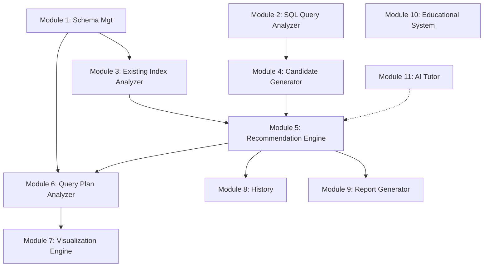

# Module Design

The system is decomposed into 11 specialized modules to ensure separation of concerns and maintainability.

## Module Details

### Module 1 — Schema Management
- **Responsibility:** Handle table creation/input, column definitions, data types, PKs, FKs, and existing indexes.
- **Features:** Schema validation, mock data population (for EXPLAIN purposes), and metadata tracking.

### Module 2 — SQL Query Analyzer
- **Responsibility:** Parse raw SQL queries.
- **Features:** Extracts elements from `SELECT`, `FROM`, `WHERE`, `JOIN`, `ORDER BY`, `GROUP BY`, and `HAVING`. Identifies column references and filtering conditions.

### Module 3 — Existing Index Analyzer
- **Responsibility:** Evaluate the currently defined indexes provided by the user.
- **Features:** Identifies indexed columns, composite indexes, duplicate indexes, and flags potentially redundant indexes.

### Module 4 — Candidate Index Generator
- **Responsibility:** Propose new indexes based on query characteristics.
- **Features:** Generates single-column indexes for simple filters, and composite indexes for combinations of WHERE, JOIN, and ORDER BY clauses.

### Module 5 — Recommendation Engine
- **Responsibility:** Rank candidate indexes.
- **Features:** Uses a documented heuristic/scoring model evaluating clause usage, selectivity, query frequency, and maintenance cost. Ensures the scoring system is transparent.

### Module 6 — Query Plan Analyzer
- **Responsibility:** Interface with MySQL's optimizer.
- **Features:** Executes `EXPLAIN` on the queries before and after simulated index creation to compare execution plans, rows examined, and cost metrics.

### Module 7 — Visualization Engine
- **Responsibility:** Render data visually on the frontend.
- **Features:** Visualizes the query processing pipeline, candidate scoring, index structures (B-Tree), and before/after query plans.

### Module 8 — History
- **Responsibility:** Persist application state.
- **Features:** Stores queries, schemas, recommendations, scores, and timestamps for user review.

### Module 9 — Report Generator
- **Responsibility:** Export findings.
- **Features:** Generates downloadable reports (PDF, DOCX, TXT) containing the complete analysis and visualizations.

### Module 10 — Educational System
- **Responsibility:** Provide learning context.
- **Features:** Houses the Learn, Help, References, and Developed By pages to satisfy the academic requirements of the project.

### Module 11 — AI Tutor (Future Phase)
- **Responsibility:** Enhance the educational experience.
- **Features:** Explains recommendations generated by the deterministic engine in natural language. Will NOT replace the core recommendation algorithm.

## Module Dependency Diagram

