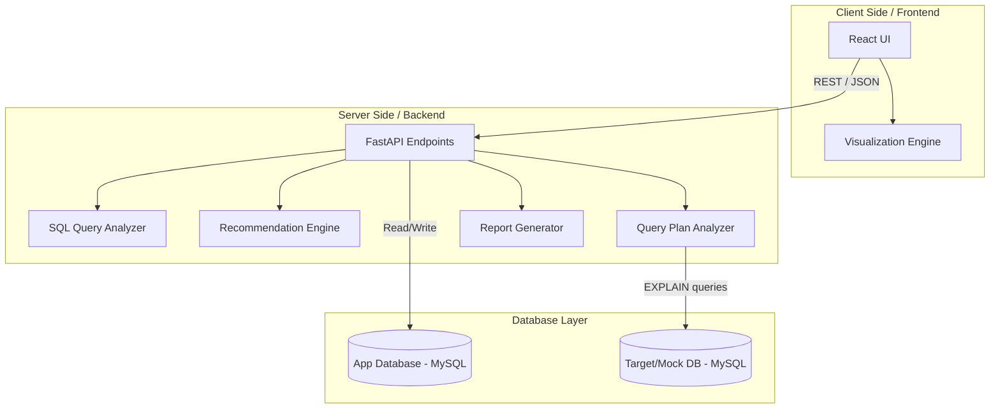
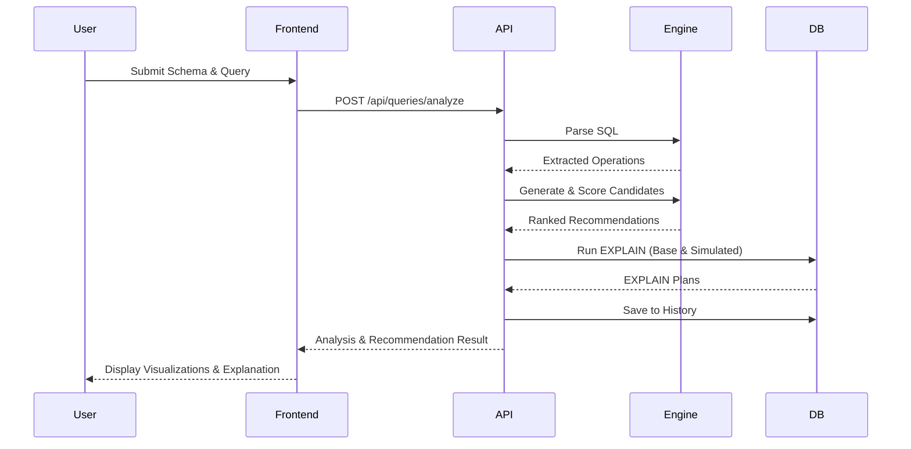

# System Architecture

## 1. System Architecture Description
The "Index Recommendation Engine" follows a standard three-tier architecture:
1. **Presentation Layer (Frontend):** A React-based web application that provides the interactive simulator, educational content, visualizations, and report generation.
2. **Application Layer (Backend):** A FastAPI Python application serving as the logic orchestrator. It handles SQL parsing, candidate generation, heuristic scoring, and interacts with the database.
3. **Data Layer (Database):** A MySQL database responsible for storing the application's history/metadata and acting as the target engine for executing `EXPLAIN` plans.

## 2. System Architecture Diagram

## 3. Data Flow
1. **Input Submission:** The user submits a schema definition, existing indexes, and an SQL query via the React frontend.
2. **Validation & Parsing:** The FastAPI backend receives the payload, validates it, and passes the SQL query to the SQL Query Analyzer.
3. **Extraction:** The analyzer extracts tables, columns, and operational clauses (WHERE, JOIN, ORDER BY, GROUP BY).
4. **Candidate Generation & Scoring:** The Recommendation Engine generates potential indexes, applies the heuristic scoring model (penalizing existing/redundant ones), and ranks them.
5. **Execution Plan Analysis:** The Query Plan Analyzer communicates with MySQL to fetch `EXPLAIN` data for the query with and without the proposed index (using mock tables or virtual indexes if supported).
6. **Response Formulation:** The backend constructs a comprehensive JSON response containing the parsed elements, scores, recommendations, and EXPLAIN diffs.
7. **Visualization:** The frontend renders the data using the Visualization Engine (D3/Mermaid) and displays the results to the user.
8. **Persistence:** The analysis and results are saved to the History tables in the App DB.

## 4. Data Flow Diagram

